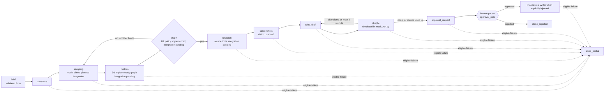

# AI Share of Voice

Measures how often a brand appears and is recommended against its competitors in an AI assistant's answers, and doubts its own results before delivering them.

Project III, Module V (AI Engineering) — AgentSquad: multi-agent system with CrewAI, LangGraph and MCP.

> Every result is a dated sample. It is never presented as market share, and no causality is claimed between a web source and a recommendation.

## Status


C1 shared contracts and the A1 LangGraph skeleton are implemented; the graph still uses simulated nodes for several steps. D1 metrics and intervals, the D2 stopping policy, and the D3 statistics tool and chart functions exist at module level, but the real stopping policy and statistics calculations are not yet wired into the end-to-end graph/report path. Supporting modules for mention extraction, agent specifications, failure handling, and reporting are also present, but they are not all connected to a real end-to-end run.

Checkpointing is configurable. A persistent checkpointer is needed to resume a human pause across process restarts. See [`docs/architecture.md`](docs/architecture.md) for module-level status and [`docs/PROJECT_PLAN.md`](docs/PROJECT_PLAN.md) for phases, owners and tasks.


## Quick start

**Requirements:** Git, Python 3.12 (3.13 also works; CrewAI does not support 3.14 yet) and `make`.

**Linux / macOS**

```bash
git clone https://github.com/JCRbit/ai-share-of-voice.git
cd ai-share-of-voice
python3.12 -m venv .venv && source .venv/bin/activate
make install
cp .env.example .env        # add your own key and spending cap
make check
```

**Windows (PowerShell)**

```powershell
winget install ezwinports.make   # skip if you already have make; then restart your terminal/editor
git clone https://github.com/JCRbit/ai-share-of-voice.git
cd ai-share-of-voice
py -3.12 -m venv .venv
.venv\Scripts\Activate.ps1       # if blocked: Set-ExecutionPolicy -Scope CurrentUser RemoteSigned
make install
Copy-Item .env.example .env      # add your own key and spending cap
make check
```

`make check` runs lint and tests; if it ends with all tests passing, your setup is ready.

# Architecture

LangGraph defines the order of work, conditional routes, bounded loops and the human approval step. CrewAI agent specifications define roles, goals, backstories, tools and iteration limits. The graph topology places human approval before finalization. The real report and tracking CSV writer must be injected explicitly; `mock_run.py` uses simulated nodes and does not activate that writer by default. Run events are logged throughout execution, including before approval.

The diagram shows the intended flow, not a fully integrated real run. D1–D3 modules exist, while the graph still uses simulated metrics and stopping behavior. The graph topology defines the Skeptic review loop, and tests exercise the real implementation when it is explicitly injected. However, `mock_run.py` builds the graph with simulated nodes. Defining a CrewAI agent specification does not mean that the agent or its tools execute in the graph. See [`docs/architecture.md`](docs/architecture.md) for the implementation status.



- How it is built and why (hybrid process, agents, tools, failure paths, status): [`docs/architecture.md`](docs/architecture.md)
- What is not delegated, risks and controls, privacy and auditing: [`docs/ethics.md`](docs/ethics.md)

## Methodology

The statistical functions in `src/ai_share_of_voice/stats/`, the stopping policy in `stats/stopping.py`, and the statistics-tool/chart modules are implemented. However, the current graph still uses simulated core nodes: its metrics node does not yet call the real statistics tool, and its stopping decision does not yet use the real stopping policy. The methodology below describes the intended measurement process; consult [`docs/architecture.md`](docs/architecture.md) before treating every step as an active runtime safeguard.


### Sampling

- A fixed set of questions (`data/questions_es.csv`, `data/questions.csv`) is sent to the model being measured. Questions are intended not to name a brand, so the process can measure whether a brand is brought up without being prompted by name.
- Questions are asked in batches. The balanced plan asks every question the same number of times, so every question weighs the same in the results.
- Each answer can be represented as one row per tracked brand (`data/competitors.csv`): mentioned, recommended, position among tracked brands, and tone. How mentions are counted is in [decision 8](docs/decisions.md#8-mention-counting-rules).
- In the intended real flow, metrics are recomputed over the answers collected so far and the stopping rule decides whether another batch is worth its cost. The metric functions and stopping policy exist, but the current graph uses simulated decisions rather than this complete integrated path.

### Metrics

Each metric is a ratio of sums, but its denominator differs: mention and recommendation rates use answers, share of voice uses tracked mentions, recommendation conversion uses mentions, and net tone uses mentions with a tone. The balanced sampling plan gives every question the same number of answers; it does not make every metric an equal-weight average over answers.

| Metric | Numerator | Denominator |
| --- | --- | --- |
| `mention_rate` | answers that mention the brand | all answers |
| `recommendation_rate` | answers that recommend the brand | all answers |
| `top1_rate` | answers where the brand is the first tracked brand | all answers |
| `share_of_voice` | mentions of the brand | mentions of all tracked brands |
| `recommendation_conversion` | answers that recommend the brand | answers that mention it |
| `net_tone` | positive minus negative mentions (from -1 to 1) | mentions with a tone |

`recommendation_conversion` is undefined for a brand that is never mentioned; it is shown as "n/a", never as 0.

### Confidence intervals (95%)

Answers to the same question are not independent: the same wording tends to bring up the same brands. We therefore have less information than the number of answers suggests, so intervals are computed with the question as the unit.

- **Wilson score interval** for binary-success ratios with a defined denominator (for example, mention rate or recommendation conversion). It behaves well near 0 and 1 and with small samples, but assumes independent trials, so on its own it may be too narrow when answers to the same question are correlated.
- **Cluster bootstrap**: whole questions are resampled with replacement (2,000 resamples, fixed seed), the metric is recomputed, and the 2.5th and 97.5th percentiles are kept. This keeps the correlation between answers to the same question. For defined metrics such as mention rate, the interval can collapse to a single point when a brand is always or never mentioned; metrics with no eligible denominator are undefined.
- **Reported interval**: for the count metrics, the hull of both (from the lower of the two lower limits to the higher of the two upper limits), so it is never narrower than either; for `share_of_voice` and `net_tone`, the cluster bootstrap. The hull is a conservative reporting rule: its coverage has not been checked by simulation.
- All brands use the same question resamples, so they are compared on the same simulated panels. Results with fewer than 10 questions are flagged as `few_questions`, because the bootstrap can be too optimistic there.

These intervals quantify uncertainty under the chosen resampling assumptions. They should not be described as calibrated 95% coverage unless that coverage has been validated.

### Stopping rule

The implemented `should_stop` policy in `stats/stopping.py` watches the half-width of the client brand's reported interval after each batch. The current graph still uses a simulated stopping decision; the rules below describe the policy that should be applied when the real policy is connected to the runtime:

1. **Precision reached**: the half-width is at or below the target, after at least `min_batches` batches and with at least 10 questions.
2. **Marginal return**: the half-width shrank by less than `marginal_gain_threshold` in each of the last `patience` batches. The half-width often shrinks roughly with the square root of the number of answers (halving it may cost about four times as many), so at some point more answers stop buying much precision.
3. **Budget exhausted**: the next batch, at the average cost of the batches so far, would go over the sampling budget. Sampling is intended to use at most `sampling_budget_share` of the run cap and leave `agent_reserve_usd` for later agent calls.
4. **Max batches** reached.

Statistical reasons come first, so the explanation says why the result is good enough, not only that a limit was hit. The policy is designed to record each decision with its reason; the current graph's simulated stopping decision does not execute this policy. Defaults: `min_batches` 2, `marginal_gain_threshold` 0.005, `patience` 2, `sampling_budget_share` 0.7, `agent_reserve_usd` 0.20. The precision target and spending caps are set in [decision 3](docs/decisions.md#3-model-provider-and-spending-cap). The average cost of previous batches is an estimate, not a guarantee.

### Limits

- A result is a dated sample of one model, in one language, with one question set. It is not market share and not what real users are shown.
- Intervals treat the questions as a sample of similar questions. They say nothing about questions phrased very differently.
- Intervals cover sampling variability only. Errors in detecting mentions, recommendations or tone are not included.
- Mentions are matched by name and variants: paraphrases ("the orange delivery app") and brands outside `data/competitors.csv` can be missed (see [decision 7](docs/decisions.md#7-untracked-brands-in-answers)).
- No causality is claimed between a cited web source and a recommendation.
- A model API response may differ from what a person sees in an assistant app, which may add web search or other settings.
- Spending limits protect only calls that pass through a client that enforces the cap. CrewAI calls are not covered until an adapter routes them through that client.

## Sections (owners)

- Installation — Ab
- Methodology — E
- Architecture, process justification and ethics — J
- Configuration and usage — An

## Contributing

See [`docs/CONTRIBUTING.md`](docs/CONTRIBUTING.md).
